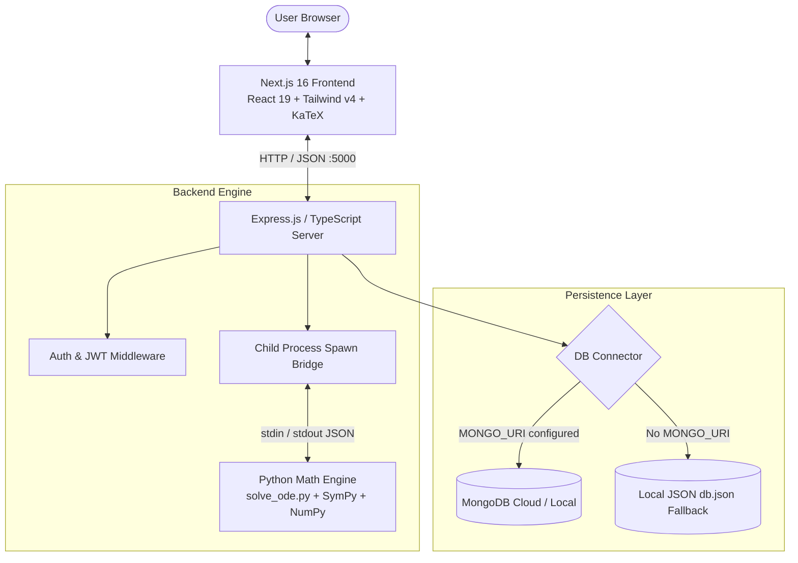

# 🧮 ODESolver — Interactive Step-by-Step Differential Equation Solver

[](https://nextjs.org/)
[](https://react.dev/)
[](https://www.typescriptlang.org/)
[](https://tailwindcss.com/)
[](https://expressjs.com/)
[](https://www.python.org/)
[](https://www.sympy.org/)
[](https://www.mongodb.com/)
[](LICENSE)

**ODESolver** is an interactive, full-stack mathematical web platform engineered to solve **Ordinary Differential Equations (ODEs)** symbolically with **pedagogical step-by-step derivations**, publication-grade **LaTeX mathematical typesetting**, interactive **2D curve visualization**, and **one-click PDF report export**.

Whether you're studying advanced calculus, physics, or differential equations, ODESolver classifies your equation, determines the optimal analytical technique, generates structured step-by-step breakdowns, and plots numerical solution curves in real time.

---

## 🌟 Key Features

* **🧠 Symbolic Math Engine (SymPy)**:
  * Solves first-order ordinary differential equations in closed form using Python's SymPy library.
  * Supports flexible mathematical syntax: **Prime notation** (`y'`, `y''`, `T'`) and **Leibniz notation** (`dy/dx`, `dT/dt`, `dP/dt`).
  * Automatic independent/dependent variable deduction (`x`, `t`, `y`, `T`, `P`, `N`, `A`, `Q`).

* **📝 Step-by-Step Pedagogical Breakdowns**:
  * **First-Order Linear ODEs**: Identifies standard form $y' + P(x)y = Q(x)$, calculates the integrating factor $\mu(x) = e^{\int P(x)dx}$, and details multiplication and integration steps.
  * **Separable Equations**: Demonstrates separation of variables $f(y)dy = g(x)dx$ followed by two-sided integration.
  * **Bernoulli Equations**: Explains substitution $v = y^{1-n}$, reduction to linear form, and back-substitution.
  * **Exact Differential Equations**: Checks the Euler reciprocity condition $\frac{\partial M}{\partial y} = \frac{\partial N}{\partial x}$ and constructs potential function $\Psi(x,y) = C$.
  * **Applied Real-World Equations**: Built-in support for **Newton's Law of Cooling**, **Exponential Growth/Decay**, and **Logistic Population Growth**.

* **📊 Interactive Curve Graphing (Recharts & NumPy)**:
  * Dynamically computes numerical solution coordinates across $x \in [-5, 5]$ with constant $C = 1$.
  * Responsive, interactive line charts with hover tooltips and coordinate inspections.

* **📄 PDF Export**:
  * Export complete solution breakdowns, equations, steps, and graphs into a beautifully formatted PDF report with a single click via `html2pdf.js`.

* **🔐 User Accounts & History Drawer**:
  * Secure JWT authentication (`bcrypt`, `jwt-simple`).
  * Slide-out calculation history drawer to reload previously solved equations instantly.

* **💾 Dual-Database Architecture**:
  * **MongoDB** connection via Mongoose for production.
  * **Zero-Config Local JSON Fallback** (`backend/db.json`): Runs immediately out-of-the-box without requiring a local or cloud MongoDB instance.

* **🎨 Modern Glassmorphism UI**:
  * Built with Next.js 16 (App Router), React 19, and Tailwind CSS v4.
  * Animated gradient orbs, Framer Motion transitions, expandable accordion step cards, and KaTeX mathematical rendering.

---

## 🏛️ System Architecture



---

## 📐 Supported Differential Equation Types

| Classification | General Form | Example Query | Method Employed |
| :--- | :--- | :--- | :--- |
| **First-Order Linear** | $y' + P(x)y = Q(x)$ | `y' = x + y` | Integrating Factor $\mu(x) = e^{\int P(x)dx}$ |
| **Separable Equations** | $f(y)\frac{dy}{dx} = g(x)$ | `y' = x * y` | Separation & Two-Sided Integration |
| **Bernoulli Equations** | $y' + P(x)y = Q(x)y^n$ | `y' + y = x*y^2` | Substitution $v = y^{1-n}$ |
| **Exact Equations** | $M(x,y)dx + N(x,y)dy = 0$ | `2*x*y + (x^2 + 1)*y' = 0` | Potential function $\Psi(x,y) = C$ |
| **Newton's Law of Cooling**| $\frac{dT}{dt} = -k(T - T_a)$ | `T' = -k*(T - Ta)` | Thermal exponential decay model |
| **Exponential Growth/Decay**| $\frac{dP}{dt} = kP$ | `P' = k*P` | Logarithmic integration |
| **Logistic Population** | $\frac{dP}{dt} = rP\left(1 - \frac{P}{K}\right)$ | `P' = r*P*(1 - P/K)` | Partial fraction expansion |

---

## 📂 Project Structure

```
ode-solver/
├── backend/                        # Node.js / Express + Python Backend
│   ├── index.ts                    # Express API server, routes & process spawner
│   ├── solve_ode.py                # SymPy mathematical parsing, ODE solving & steps
│   ├── db.ts                       # MongoDB connection handler
│   ├── mockDb.ts                   # Lightweight JSON file database fallback
│   ├── models/
│   │   ├── User.ts                 # User model (Mongoose / Mock)
│   │   └── History.ts              # Equation history model (Mongoose / Mock)
│   ├── requirements.txt            # Python dependencies (SymPy, NumPy)
│   ├── package.json                # Backend npm dependencies and scripts
│   ├── tsconfig.json               # Backend TypeScript configuration
│   └── .env.example                # Backend environment template
├── frontend/                       # Next.js 16 App Router Frontend
│   ├── src/
│   │   └── app/
│   │       ├── page.tsx            # Main solver interface, charts, auth modal
│   │       ├── layout.tsx          # Root layout & font definitions
│   │       └── globals.css         # Tailwind v4 directives & glassmorphic styles
│   ├── public/                     # Static assets & SVG icons
│   ├── package.json                # Frontend npm dependencies and scripts
│   ├── next.config.ts              # Next.js configuration
│   ├── tsconfig.json               # Frontend TypeScript configuration
│   └── .env.example                # Frontend environment template
├── render.yaml                     # Render deployment blueprint (Backend)
├── LICENSE                         # MIT License
└── README.md                       # Repository documentation
```

---

## 🚀 Quickstart Guide

### Prerequisites
* **Node.js**: v18.0.0 or higher (v20+ recommended)
* **npm** or **pnpm**
* **Python**: v3.10 or higher
* **Git**

---

### Step 1: Clone the Repository
```bash
git clone https://github.com/rangithkumarpathyam-collab/ode-solver.git
cd ode-solver
```

---

### Step 2: Setup the Backend

1. **Navigate to the `backend` directory:**
   ```bash
   cd backend
   ```

2. **Install Node.js dependencies:**
   ```bash
   npm install
   ```

3. **Set up the Python Virtual Environment:**
   ```bash
   # Windows
   python -m venv venv
   .\venv\Scripts\activate
   pip install -r requirements.txt

   # Linux / macOS
   python3 -m venv venv
   source venv/bin/activate
   pip install -r requirements.txt
   ```

4. **Configure Environment Variables:**
   ```bash
   # Windows PowerShell
   Copy-Item .env.example .env

   # Linux / macOS
   cp .env.example .env
   ```
   *(Note: `MONGO_URI` is optional. If left blank, the backend automatically uses `db.json` local storage).*

5. **Start the backend development server:**
   ```bash
   npm run dev
   ```
   The backend server will run on **`http://localhost:5000`**.

---

### Step 3: Setup the Frontend

In a new terminal window:

1. **Navigate to the `frontend` directory:**
   ```bash
   cd ../frontend
   # or from root: cd frontend
   ```

2. **Install frontend dependencies:**
   ```bash
   npm install
   ```

3. **Configure Environment Variables:**
   ```bash
   # Windows PowerShell
   Copy-Item .env.example .env.local

   # Linux / macOS
   cp .env.example .env.local
   ```

4. **Start the Next.js development server:**
   ```bash
   npm run dev
   ```

5. **Open the Application:**
   Visit **`http://localhost:3000`** in your browser.

---

## ⚙️ Environment Variables Reference

### Backend (`backend/.env`)

| Variable | Required | Description | Default |
| :--- | :---: | :--- | :--- |
| `PORT` | Optional | Port for Express server | `5000` |
| `JWT_SECRET` | Optional | Secret key for signing auth tokens | `supersecretkey123` |
| `MONGO_URI` | Optional | MongoDB connection string (falls back to `db.json` if omitted) | `""` |

### Frontend (`frontend/.env.local`)

| Variable | Required | Description | Default |
| :--- | :---: | :--- | :--- |
| `NEXT_PUBLIC_API_URL` | Optional | Base URL for backend API calls | `http://localhost:5000` |

---

## 📡 REST API Reference

### 1. Solve Equation
* **Endpoint**: `POST /api/solve`
* **Headers**: `Authorization: Bearer <token>` *(Optional, automatically saves to history if provided)*
* **Body**:
  ```json
  {
    "equation": "y' = x + y"
  }
  ```
* **Response**:
  ```json
  {
    "success": true,
    "equation": "\\frac{d}{dx} y{\\left(x \\right)} = x + y{\\left(x \\right)}",
    "type": "1St Linear",
    "solution_latex": "y{\\left(x \\right)} = C_{1} e^{x} - x - 1",
    "steps": [
      {
        "title": "Identify equation type",
        "detail": "This is a First-Order Linear Differential Equation.",
        "latex": ""
      },
      {
        "title": "Standard Form",
        "detail": "Ensure the equation is in the form y'(x) + P(x)y(x) = Q(x)",
        "latex": ""
      },
      {
        "title": "Final Answer",
        "detail": "After integration and simplification:",
        "latex": "y{\\left(x \\right)} = C_{1} e^{x} - x - 1"
      }
    ],
    "plotData": [
      { "x": -5.0, "y": 3.99 },
      { "x": -4.9, "y": 3.89 }
    ]
  }
  ```

### 2. User Authentication
* **Register**: `POST /api/auth/register` (`{ "name": "...", "email": "...", "password": "..." }`)
* **Login**: `POST /api/auth/login` (`{ "email": "...", "password": "..." }`)

### 3. Calculation History
* **Endpoint**: `GET /api/history`
* **Headers**: `Authorization: Bearer <token>`
* **Response**: List of user's previously solved equations and solution metadata.

### 4. Health & Diagnostics
* `GET /api/health`: Service health check (`{ "status": "ok" }`).
* `GET /api/debug`: Returns environment paths, python executable verification, and script presence.

---

## ☁️ Deployment

### Backend (Render)
The repository includes a ready-to-use [`render.yaml`](render.yaml) specification:
1. Connect your GitHub repository to [Render](https://render.com/).
2. Deploy as a **Web Service** using the `render.yaml` blueprint.
3. Configure `MONGO_URI` and `JWT_SECRET` in the Render environment settings.

### Frontend (Netlify or Vercel)
* **Vercel**: Import the `frontend` subfolder as a Next.js project and set `NEXT_PUBLIC_API_URL` to your Render backend URL.
* **Netlify**: Uses the bundled `frontend/netlify.toml` for automatic Next.js build and routing.

---

## 🤝 Contributing

Contributions, bug reports, and suggestions are welcome!
1. Fork the Project
2. Create your Feature Branch (`git checkout -b feature/NewODEType`)
3. Commit your Changes (`git commit -m 'Add support for second order linear ODEs'`)
4. Push to the Branch (`git push origin feature/NewODEType`)
5. Open a Pull Request

---

## 📄 License

This project is licensed under the **MIT License** — see the [LICENSE](LICENSE) file for details.
